<div align="center">

# agent-saifu

**The all-in-one crypto wallet for AI agents.**<br>
Built from the ground up in Rust. Driven entirely through MCP.

</div>

<br>

## Blockchain coverage

| Blockchain | Status |
|------------|--------|
| Ethereum | ✅ Fully covered |
| ETH Layer 2s (Base, Arbitrum, Optimism and any EVM network you add) | ✅ Fully covered |
| Sui (mainnet, testnet, devnet; swaps on mainnet via Cetus) | ✅ Covered (see the tool table in spec.md for what works with which wallet) |
| Solana | 🔜 Soon |
| Bitcoin | 🔜 Soon |

<p align="center">
  
</p>

## Secure by design

Every wallet lives in its own encrypted vault. An agent unlocks exactly one wallet for exactly one action, and it locks again the moment the call returns.

<p align="center">
  
</p>

## Swap tokens with confidence

Preview a swap, compare routes through OpenOcean, and submit it. The wallet decodes and verifies the transaction before signing anything.

<p align="center">
  
</p>

## Connect to any dapp

Pair with Uniswap, OpenSea, Aave and more over WalletConnect v2. The agent reviews every proposal and request before anything is approved or signed.

<p align="center">
  
</p>

## Features

- **Agent-native:** every capability is an MCP tool over stdio JSON-RPC, with structured results.
- **Vaults you can trust:** MetaMask-compatible encryption (PBKDF2-HMAC-SHA256 and AES-256-GCM) with 24-word BIP39 seed phrases.
- **Per-action unlock:** one wallet at a time, locked again after every call. Addresses and balances stay hidden until unlocked.
- **Multiple wallets:** create or import wallets, each with its own password, networks and tokens.
- **Ethereum and layer 2s:** add custom networks per wallet and check balances across all of them, with USDC values.
- **Sui:** create or import Ed25519 wallets (the same 24-word phrases and `suiprivkey` keys as Slush and the Sui CLI), bound to mainnet, testnet or devnet, built on the official Sui Rust SDK. Send any coin, sign transactions and messages (Wallet Standard equivalents), and swap through the Cetus aggregator.
- **Safe transactions:** estimate fees, simulate before signing, decode approvals, and revoke them when finished.
- **Token swaps:** quotes and swaps through OpenOcean (Ethereum) and Cetus (Sui), with local verification and slippage protection.
- **WalletConnect v2:** connect to any dapp, review the expected outcome of each request, then approve or reject it.
- **No double payments:** signed transactions are recorded before broadcast, so a lost response is never paid twice.
- **Minimal dependencies:** hashing, ABI, RLP, EIP-712, BIP32/39 and WalletConnect logic are implemented in-repo and tested against published vectors.
- **Encrypted export:** back up a wallet as a ZIP protected with MetaMask's vault scheme.


## Setup + Learn more

See [**spec.md**](spec.md) for every tool, the full security design, setup instructions, and worked examples. Agents and humans alike should start there.

1. Download the latest [release](https://github.com/daniel-j-dev/agent-saifu/releases) and extract it. 
2. After, ask your agents create a wallet, show your balance, send, swap & more. 

Problems? If your agent is confused about anything, tell it to read the `spec.md` file for context. This is included in the release zip files.

### Example chat


User prompt:

```
Send all the USDC and eth to 0x47b48420a2C6E57017F25Fe6709677cd62c09305
```


Agent output:

```
Task completed:

I sent all the USDC and nearly all the ETH from Demo to 0x47b48420a2C6E57017F25Fe6709677cd62c09305 on Arbitrum One. Both transactions show success. Demo held nothing on Ethereum mainnet, so Arbitrum was the only place to send from.

USDC: 9.127654, the full balance. Transaction 0x73ff…05fe.
ETH: 0.002319996 ETH. Transaction 0x6bbd…470c.
What's left in Demo: about 0.0000012 ETH, which is 1,171,052,026,000 wei. I couldn't send exactly everything because a transfer needs gas. I held back about 0.0000016 ETH so a fee swing wouldn't make the send fail, and the actual fee came to less.
Pending record: the pending-transaction folder was empty after both sends.
```

## Disclaimer

agent-saifu is experimental software provided "as is", without warranty of any kind. It has not been independently audited. Use it at your own risk, and never with funds you cannot afford to lose.

The author and contributors are not responsible or liable for any loss or damage of any kind, including but not limited to lost, stolen, or misdirected funds, lost or leaked seed phrases, private keys, or passwords, failed or incorrect transactions, bugs, or actions taken by AI agents using this software. You are solely responsible for backing up your seed phrases and keeping your passwords safe. This is not financial advice.
